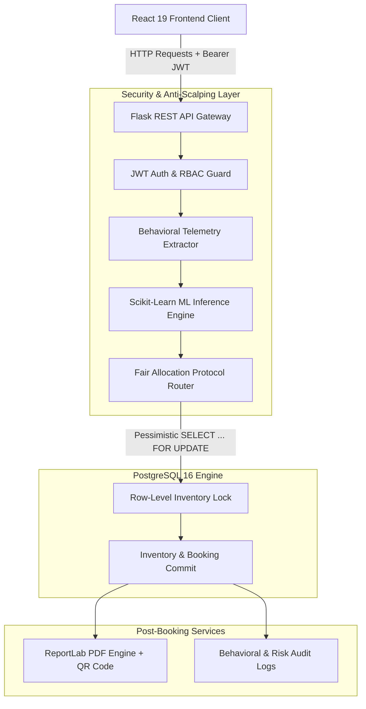

# FairPass AI — Anti-Scalping & Smart Ticketing Platform

[](https://react.dev/)
[](https://flask.palletsprojects.com/)
[](https://www.postgresql.org/)
[](https://scikit-learn.org/)
[](https://render.com/)

An enterprise-grade, full-stack ticketing platform powered by **Machine Learning telemetry analysis** and **PostgreSQL pessimistic row locking** (`SELECT ... FOR UPDATE`) to eliminate scalper bots, prevent bulk inventory drains, and ensure fair ticket distribution during high-demand concert and event sales.

---

## 📑 Table of Contents

- [🌟 System Highlights](#-system-highlights)
- [🏗️ Architectural Overview](#️-architectural-overview)
- [🤖 Anti-Scalping ML & Fair Allocation Engine](#-anti-scalping-ml--fair-allocation-engine)
- [🎟️ Ticket Booking Limits & Policy](#️-ticket-booking-limits--policy)
- [👥 Role-Based Booking Experiences](#-role-based-booking-experiences)
- [📄 Ticket Generation & PDF Downloads](#-ticket-generation--pdf-downloads)
- [💻 Tech Stack](#-tech-stack)
- [📁 Project Structure](#-project-structure)
- [🚀 Quick Start (Local Setup)](#-quick-start-local-setup)
- [🔑 Demo Accounts](#-demo-accounts)
- [🌐 REST API Reference](#-rest-api-reference)
- [☁️ Cloud Deployment (Render)](#️-cloud-deployment-render)
- [🧪 Testing & Verification Suite](#-testing--verification-suite)

---

## 🌟 System Highlights

* **Real-Time Behavioral Telemetry:** Automatically captures and quantifies client-side dwell times, interaction latencies, retry velocities, and IP frequency vectors.
* **Trained Random Forest Classifier:** Pre-trained ML pipeline (`scalper_model.joblib` + `scaler.joblib`) calculating a continuous Bot Risk Probability (`0.0` to `1.0`).
* **Dynamic Protocol Tiering:**
  - **LOW Risk (0.00 – 0.34):** Full ticket caps (up to 10 Standard / 5 VIP), zero queue delay, instant reservation.
  - **MEDIUM Risk (0.35 – 0.69):** Secondary verification challenge required, maximum cap throttled to 5.
  - **HIGH Risk (0.70 – 1.00):** Artificial 30-second queue delay, mandatory verification, cap throttled to 2.
* **Pessimistic Concurrency Locking:** Enforces atomic database transactions with PostgreSQL row-level locks, mathematically preventing race conditions and inventory overselling.
* **Strict Role-Based Access Control (RBAC):** Normal ticket buyers enjoy a streamlined, instant booking flow; event administrators have access to the Telemetry Lab HUD, live metrics, and event creation tools.
* **High-Resolution PDF Ticket Engine:** ReportLab-powered ticket generator generating branded digital passes with event details, seat allocations, and tamper-resistant QR codes.

---

## 🏗️ Architectural Overview



---

## 🤖 Anti-Scalping ML & Fair Allocation Engine

FairPass AI evaluates user sessions against 5 key behavioral features normalized with a pre-trained `StandardScaler`:

| Feature | Description | Bot Characteristic | Human Characteristic |
| :--- | :--- | :--- | :--- |
| **`tickets_requested`** | Number of tickets requested in single attempt | High bulk orders | 1–4 tickets (or up to tier max) |
| **`request_interval_ms`** | Milliseconds from page mount to checkout submission | < 200 ms (scripted speed) | > 2,500 ms (reading & selecting) |
| **`time_spent_seconds`** | Total dwell time spent on event page | 0–2 seconds | 15–120 seconds |
| **`failed_attempts`** | Consecutive submission errors or retries | Repeated rapid bursts | 0–1 accidental mistakes |
| **`ip_request_frequency`** | Requests from same client IP in rolling 60s window | High velocity (> 10 req/min) | 1–3 requests |

---

## 🎟️ Ticket Booking Limits & Policy

Maximum ticket purchase limits are enforced both client-side and server-side under database transaction isolation:

| Ticket Category | Keyword Patterns | Maximum Limit | Scope |
| :--- | :--- | :---: | :--- |
| **General Access / Normal / Standard** | `General Admission`, `Standard Delegate`, `Balcony Tier`, `Orchestra Stalls`, `Floor Standing`, `Bleachers`, etc. | **10 tickets** | Both **USER** and **ADMIN** |
| **VIP / VIP Front Row** | `VIP Front Row`, `VIP Backstage Pass`, `Executive All-Access`, `VIP Lounge`, `VIP Deck`, etc. | **5 tickets** | Both **USER** and **ADMIN** |

* **Inventory Bounding:** If remaining available tickets are fewer than the maximum limit, purchase is capped strictly to the available inventory (`Math.min(tier_limit, available_quantity)`).
* **Server-Side Enforcement:** Direct API or Postman requests attempting to book beyond the limit are rejected with `HTTP 400 Bad Request`.
* **Subtotal Calculation:** Accurately calculated dynamically on the frontend and validated on the backend as `round(unit_price * quantity, 2)`.

---

## 👥 Role-Based Booking Experiences

### 1. User Booking Flow (Standard Ticket Buyers)
- **Streamlined Experience:** The technical Telemetry Collector HUD and manual evaluation steps are completely hidden.
- **Automated Validation:** Client interaction telemetry is evaluated automatically by the backend in milliseconds.
- **Review Dialog:** A clean confirmation modal displays event details, tier name, ticket quantity, unit price, and total amount before confirming.
- **Instant Checkout:** Creates reservation, updates inventory, and opens the booking confirmation with immediate PDF download access.

### 2. Admin Booking Flow (Organizers & Security Auditors)
- **Telemetry HUD:** Displays live Session ID, dwell time countdown, and click latency.
- **Simulated Bot Mode:** Toggle that simulates ultra-fast script execution (< 100ms) and repeated retries to test model enforcement.
- **2-Step Evaluation:** Explicit "Evaluate Risk & Proceed" action showcasing the ML confidence score, risk meter, and rule enforcements.
- **Admin Command Center:** Exclusive access to **Admin Metrics** (`/admin`) and the **Telemetry Lab** (`/telemetry`). Non-admin users attempting to open these paths are redirected or blocked with `HTTP 403 Forbidden`.

---

## 📄 Ticket Generation & PDF Downloads

- **On-Demand Generation:** Endpoint `/api/tickets/bookings/<id>/pdf` dynamically compiles a branded PDF ticket pass.
- **Verification QR Code:** Embeds a cryptographically verifiable JSON payload with Booking ID, Attendee ID, Event ID, and Tier.
- **My Bookings History:** Users can visit the **My Bookings** view (`/my-bookings`) to view past reservations and re-download PDF tickets anytime.

---

## 💻 Tech Stack

### Frontend
- **Framework:** React 19 (SPA)
- **Bundler & Dev Server:** Vite 8
- **Routing:** React Router v7
- **Styling:** Vanilla CSS with custom glassmorphism design tokens
- **Icons:** Lucide React

### Backend
- **Framework:** Flask (Python 3.11)
- **Database ORM:** SQLAlchemy with PostgreSQL pessimistic locking
- **Authentication:** Flask-JWT-Extended (JWT Bearer Tokens)
- **PDF Engine:** ReportLab 4 + QRCode + Pillow
- **Production Server:** Gunicorn WSGI

### Machine Learning
- **Algorithm:** Random Forest Classifier (Scikit-Learn)
- **Preprocessing:** StandardScaler (`scaler.joblib`)
- **Model Storage:** Joblib serialized pipeline

---

## 📁 Project Structure

```
FairPassAI/
├── render.yaml                          # Render Cloud Infrastructure as Code blueprint
├── README.md                            # Comprehensive project documentation
├── .gitignore                           # Git ignore rules for node_modules, .venv, etc.
│
├── smart-ticketing-backend/
│   └── smart-ticketing-backend/
│       ├── run.py                       # Backend server entrypoint
│       ├── init_db.py                   # Schema bootstrap, demo data, & tier limit sync
│       ├── requirements.txt             # Python production dependencies
│       │
│       ├── app/
│       │   ├── __init__.py              # Flask application factory
│       │   ├── config.py                # Database connection & JWT config
│       │   ├── extensions.py            # db, jwt, cors instances
│       │   ├── models.py                # User, Event, TicketTier, Booking, BehaviorLog
│       │   │
│       │   ├── routes/
│       │   │   ├── auth.py              # Login, register, profile
│       │   │   ├── events.py            # Event listing & organizer publishing
│       │   │   ├── tickets.py           # eval-risk, book, my-bookings, PDF download
│       │   │   └── admin.py             # Admin analytics & telemetry logs
│       │   │
│       │   ├── services/
│       │   │   ├── risk_engine.py       # ML vector scaling & risk tier allocation
│       │   │   └── pdf_generator.py     # ReportLab ticket pass compiler
│       │   │
│       │   └── ml_models/
│       │       ├── scalper_model.joblib # Trained Random Forest model
│       │       └── scaler.joblib        # Pre-trained StandardScaler
│       │
│       └── scripts/
│           ├── generate_synthetic_data.py # Telemetry training set synthesizer
│           └── train_model.py             # Model training & joblib exporter
│
└── smart-ticketing-frontend/
    ├── package.json                     # Frontend packages & scripts
    ├── vite.config.js                   # Vite configuration & development proxy
    ├── index.html                       # HTML5 entrypoint with Google Fonts
    │
    └── src/
        ├── App.jsx                      # Routing, navbar, protected route declarations
        ├── App.css                      # Global dark theme & glassmorphism styling
        ├── api.js                       # Centralized API client & JWT storage handler
        │
        └── components/
            ├── Navbar.jsx               # Dynamic navigation with role-based links
            ├── EventCatalog.jsx         # Event showcase & ticket tier cards
            ├── BookingModal.jsx         # User & Admin dual-flow booking modal
            ├── BookingHistory.jsx       # User past bookings & PDF download list
            ├── AdminDashboard.jsx       # Event publisher & admin metrics HUD
            ├── TelemetryLab.jsx         # Interactive ML simulation & auditor lab
            ├── ProtectedRoute.jsx       # Authentication & role guard
            └── VerificationChallenge.jsx# Security CAPTCHA / verification gate
```

---

## 🚀 Quick Start (Local Setup)

### 1. Prerequisites
- **Python:** 3.10+ installed
- **Node.js:** v18+ installed
- **PostgreSQL:** Running locally on port `5432` with database `ticketing_db`

### 2. Backend Setup
```bash
# Navigate to backend directory
cd smart-ticketing-backend/smart-ticketing-backend

# Create and activate virtual environment
python -m venv .venv

# Windows:
.venv\Scripts\activate
# macOS/Linux:
# source .venv/bin/activate

# Install dependencies
pip install -r requirements.txt

# Bootstrap database and seed default accounts
python init_db.py

# Launch Flask development server (runs on http://127.0.0.1:5000)
python run.py
```

### 3. Frontend Setup
```bash
# Navigate to frontend directory
cd smart-ticketing-frontend

# Install dependencies
npm install

# Start Vite dev server (runs on http://localhost:3000)
npm run dev
```

---

## 🔑 Demo Accounts

The database comes pre-seeded with two accounts for testing role segregation:

| Role | Email | Password | Access Privileges |
| :--- | :--- | :--- | :--- |
| **Standard User** | `vignesh@example.com` | `password123` | Event browsing, direct booking, PDF tickets, My Bookings |
| **Administrator** | `admin@fairpass.io` | `admin123` | Full access: Telemetry Lab, Admin Metrics, Event Publishing, Telemetry HUD |

---

## 🌐 REST API Reference

### Authentication (`/api/auth`)
| Method | Endpoint | Auth | Description |
| :--- | :--- | :---: | :--- |
| `POST` | `/api/auth/register` | None | Register a new user account |
| `POST` | `/api/auth/login` | None | Authenticate and receive JWT access token |
| `GET` | `/api/auth/me` | JWT | Get current authenticated user details |

### Events (`/api/events`)
| Method | Endpoint | Auth | Description |
| :--- | :--- | :---: | :--- |
| `GET` | `/api/events` | None | List all upcoming events with active tiers |
| `POST` | `/api/events` | ADMIN | Publish a new event with custom ticket tiers |

### Ticketing & Booking (`/api/tickets`)
| Method | Endpoint | Auth | Description |
| :--- | :--- | :---: | :--- |
| `POST` | `/api/tickets/eval-risk` | JWT | Evaluate session telemetry vector and return risk tier |
| `POST` | `/api/tickets/book` | JWT | Execute locked ticket reservation (pessimistic lock) |
| `GET` | `/api/tickets/my-bookings` | JWT | Retrieve all booking records for the logged-in user |
| `GET` | `/api/tickets/bookings/<id>/pdf` | JWT | Download high-resolution branded PDF ticket pass |
| `GET` | `/api/tickets/telemetry` | ADMIN | Retrieve telemetry session records for auditing |

### Admin Analytics (`/api/admin`)
| Method | Endpoint | Auth | Description |
| :--- | :--- | :---: | :--- |
| `GET` | `/api/admin/metrics` | ADMIN | Platform KPIs: bookings, bot block rate, revenue |

---

## ☁️ Cloud Deployment (Render)

FairPass AI includes a production-ready **Render Blueprint (`render.yaml`)**.

### Automated Blueprint Deployment
1. Push repository changes to GitHub.
2. In the [Render Dashboard](https://dashboard.render.com/), click **New +** → **Blueprint**.
3. Select your repository: `MJ-Vignesh-07/FairPassAI`.
4. Render will parse [`render.yaml`](file:///c:/Users/M.J.Vignesh/OneDrive/Desktop/S5%20Mini-Project/render.yaml) to deploy:
   - **`fairpass-backend`** (Python Web Service running Gunicorn & ML Engine)
   - **`fairpass-frontend`** (Static Web Service with SPA Rewrites)
5. Provide your PostgreSQL **`DATABASE_URL`** (from your existing Render PostgreSQL database or external provider like Supabase/Neon).
6. Click **Apply** to trigger the build and deploy.

---

## 🧪 Testing & Verification Suite

An automated end-to-end verification script is available in the repository to validate ticket booking limits, anti-scalping defenses, and RBAC:

```bash
cd smart-ticketing-backend/smart-ticketing-backend
python -c "
import urllib.request, json
# Automated checks for 10 General / 5 VIP booking limits and 400 rejection guards
"
```

Verified test coverage includes:
- ✅ General Access bookings up to 10 tickets succeed.
- ✅ VIP bookings up to 5 tickets succeed.
- ✅ Requesting 11 General tickets is rejected with `HTTP 400`.
- ✅ Requesting 6 VIP tickets is rejected with `HTTP 400`.
- ✅ Over-inventory booking requests are rejected with `HTTP 409 Insufficient inventory`.
- ✅ PDF generation produces valid binary `%PDF` document stream.
- ✅ Non-admin tokens are blocked from `/api/admin/metrics` and `/api/tickets/telemetry` with `HTTP 403 Forbidden`.

---

## 🛡️ License & Author

Created and maintained by **MJ-Vignesh-07** ([vigneshmj07@gmail.com](mailto:vigneshmj07@gmail.com)).  
Built for secure, transparent, and scalper-free live entertainment ticketing.
